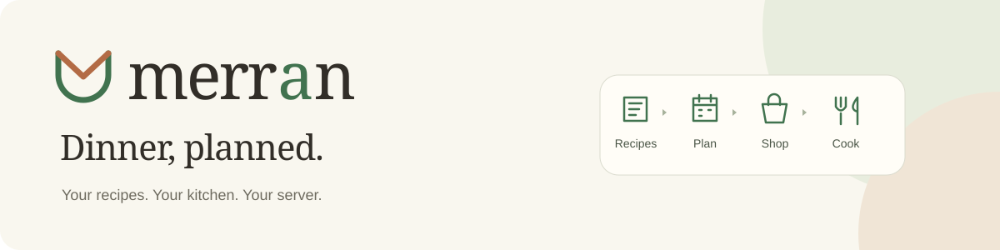
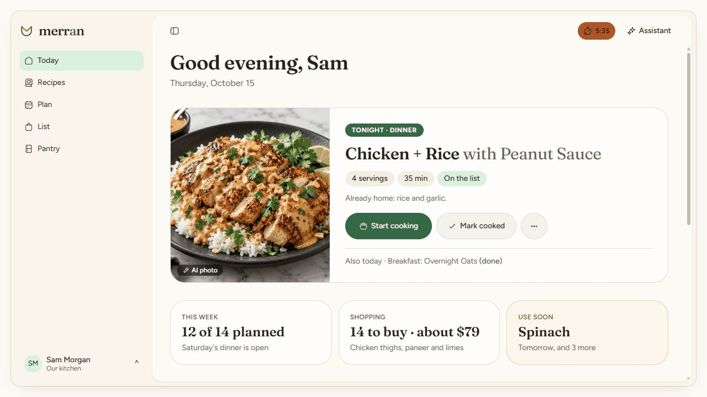

<p align="center">
  
</p>

<p align="center">
  <a href="https://github.com/merran-app/merran/releases"></a>
  <a href="https://github.com/merran-app/merran/actions/workflows/ci.yml"></a>
  <a href="https://github.com/merran-app/merran/stargazers"></a>
  <a href="https://github.com/merran-app/merran/graphs/contributors"></a>
  <a href="https://github.com/merran-app/merran/issues"></a>
  <a href="LICENSE"></a>
</p>

<!-- Once the first release is published, use the live version badge:
https://img.shields.io/github/v/release/merran-app/merran?include_prereleases=true&style=flat-square&color=41734f&label=release
-->

<p align="center">
  <strong>Your recipes. Your kitchen. Your server.</strong><br>
  A self-hosted meal planner for households, with an optional AI cooking assistant.
</p>

<p align="center">
  <a href="https://merran.app/docs/"><strong>Documentation</strong></a> ·
  <a href="https://merran.app/docs/get-started/install/">Install</a> ·
  <a href="https://merran.app/docs/api/">API</a> ·
  <a href="https://github.com/merran-app/merran/releases">Releases</a> ·
  <a href="https://github.com/merran-app/merran/issues">Report a bug</a>
</p>

[](.github/assets/merran-recipes.png)

<p align="center">
  Still images: <a href=".github/assets/merran-today.png">Today</a> ·
  <a href=".github/assets/merran-recipes.png">Recipes</a> ·
  <a href=".github/assets/merran-plan.png">Plan</a>
</p>

_Light-mode app previews with sample data and AI-generated recipe photos. The slideshow changes view every 4.5 seconds; use the links above for still images._

## One loop, every week

- **Collect recipes** from websites, write your own, or migrate from Mealie and other supported apps.
- **Plan meals** with serving counts, theme preferences, and suggestions from your library.
- **Shop and track the pantry** with shared lists, combined quantities, and food you already have accounted for.
- **Cook at the counter** with step-by-step instructions, ingredient checklists, and timers.
- **Add AI when you want it** for imports, substitutions, and an assistant that proposes kitchen changes for review.
- **Make it yours** with separate households, three palettes, a browser extension, and an API with scoped keys.

Core recipes, planning, lists, and pantry tracking work without AI. AI, nutrition, voice, and store connections have their own setup requirements. Start with [your first week](https://merran.app/docs/get-started/first-week/).

## Get started

The [installation guide](https://merran.app/docs/get-started/install/) includes TrueNAS, Dockge, and Portainer examples, plus complete [Postgres, Kokoro voice, and tunnel setup](https://merran.app/docs/get-started/install/#optional-services-with-compose). The project's `compose.yaml` also has FlareSolverr, for importing from sites that turn servers away (not released yet).

Merran runs in one Docker container with SQLite included. Postgres is optional. The image includes application dependencies; no separate Node package installation is needed on the host.

Use the **:next** release channel while Merran is in alpha:

```bash
mkdir data
docker run -d --name merran --restart unless-stopped \
  -p 3000:3000 -v "$(pwd)/data:/data" ghcr.io/merran-app/merran:next
docker logs merran
```

Open **http://YOUR-SERVER:3000** and use the setup code from the log to create your account and household.

**Merran is in alpha.** `next` follows published releases, including alphas; `edge` follows development on main. The docs will recommend `latest` with the first full release. You can pin a specific published version if you prefer to choose when to change versions. Never delete the persistent data directory when recreating Merran: it contains the database, photos and server secret. Back up the complete directory before updating.

See the [installation guide](https://merran.app/docs/get-started/install/) for Docker Compose and image tags, and [updating and backups](https://merran.app/docs/run/updating-and-backups/) for maintaining your server.

## Find your way

| I want to…                     | Start here                                                                                                                                                                    |
| ------------------------------ | ----------------------------------------------------------------------------------------------------------------------------------------------------------------------------- |
| Import and organize recipes    | [Recipes](https://merran.app/docs/use/recipes/)                                                                                                                               |
| Plan, shop, and cook           | [Planning](https://merran.app/docs/use/planning/) · [Shopping and pantry](https://merran.app/docs/use/shopping-and-pantry/) · [Cooking](https://merran.app/docs/use/cooking/) |
| Set up AI and understand costs | [AI setup](https://merran.app/docs/run/ai-setup/) · [Privacy and data flow](https://merran.app/docs/project/ai-privacy/)                                                      |
| Configure or fix my server     | [Configuration](https://merran.app/docs/run/configuration/) · [Troubleshooting](https://merran.app/docs/run/troubleshooting/)                                                 |
| Connect another tool           | [API quickstart](https://merran.app/docs/api/) · [OpenAPI schema](https://merran.app/openapi.json)                                                                            |
| Install the browser extension  | [Extension guide](apps/extension/README.md)                                                                                                                                   |

Visit [merran.app](https://merran.app/) for the product overview, documentation, and API reference.

See the [public roadmap](https://merran.app/docs/project/roadmap/) for what is up next, planned features, and ideas open for feedback.

## Contribute

Bug reports, documentation improvements, and code contributions are welcome. See the [contributor guide](https://merran.app/docs/project/contribute/).

For local development, use Node 24 and the repository's pinned pnpm version:

```bash
corepack enable
pnpm install
pnpm dev
```

The app runs on **http://localhost:5173**, with its API on port **3000**. Run `pnpm docs:dev` for the public site. Development checks and API-generation commands are covered in the contributor guide; internal plans live in [docs/](docs/README.md).

For repeatable setup development: set `MERRAN_DEV_SETUP=on` in the shell before `pnpm dev` to use a fresh temporary SQLite database on every server start. The normal database is untouched; the flag is rejected in production and Docker installs. See [setup development](docs/onboarding.md#development-testing). Alpha.4 also provides `docker exec merran merran setup-code` to retrieve a buried setup code and `docker exec -it merran merran reset-password USERNAME` for operator recovery.

Read [AGENTS.md](AGENTS.md) for repository conventions and what to update with each change. Pull request titles use a kind such as `feat:`, `fix:`, or `docs:`; release drafts are assembled from merged PRs. See the [release process](docs/operations.md#releases-and-updates) before running the Release workflow on main.

## License

Copyright © 2026 Kyle Johnson. Merran is licensed under [AGPL-3.0-or-later](LICENSE). Public documentation is shared under [CC BY 4.0](https://creativecommons.org/licenses/by/4.0/).
